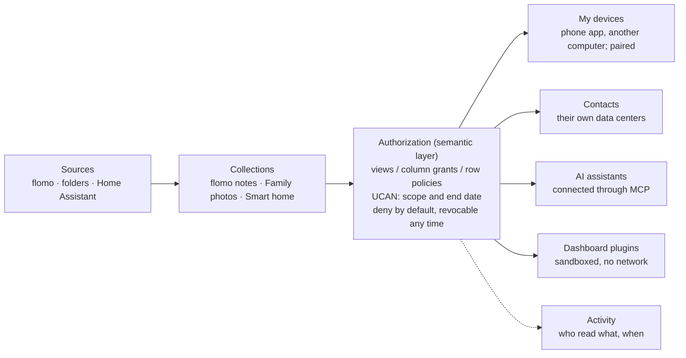

# Oikome Apps PRD

> Drafted on 2026-11-01 in Claude Docs. Since 2026-11-04 it lives in the repository and changes together with [`architecture.md`](architecture.md) and [`prototype/`](prototype/prototype.html). Where they disagree, the architecture decides technical facts and the prototype decides the interface.

## Background and Problem

Conclusion: the apps face users only. They are "my data center", and Home is a dashboard that plugins can add cards to. There are no operations or developer pages; those stay in the command line. For now the focus is a personal private data center; member roles come later.

- **The state when the work began (2026-11-01):** `web/` was the browser node of phase 3.2, wrapping `oikome-wasm` with duckdb-wasm, IndexedDB and WebRTC. The page showed only a DID, and SQL had to be typed into the browser's developer console. A Full Node could be managed only with the `oikome sql` command line; there was no web entry point. The web app has since reached M2 (see Milestones).
- **Problem:** Oikome is meant as a private data center for individuals, families and small teams, but at the time only developers who write SQL and understand Spaces and UCANs could use it. Owners could not easily browse their own data or look at it on their phones, and friends could not safely receive a share.
- **Why not an operations console:** turning CREATE SPACE and ISSUE UCAN into forms only changes how they are typed; users still have to understand the concepts underneath. Ordinary users care about where their notes, photos and home sensor readings are, who can see them, and what AI can see.
- **What this PRD answers:** who the apps are for, what they do, how they look, how plugins plug in, and what the back end needs for it.

## Target Users and Core Scenarios

For now the focus is a personal private data center. The apps serve only the data's owner, on their own computer and phone. Friends use them only when receiving a share. Family members (member roles) come later. Documentation and debugging tools for plugin developers are not in the apps.

| User | Who | What they do most | How they get in |
| --- | --- | --- | --- |
| Data owner (primary) | Whoever installed Oikome, with an always-on computer or NAS; may not know databases | Connect apps, browse and search their data, install dashboard plugins, control what AI can see, share with friends | A browser on the computer opens the local web page; a phone with the Oikome app can also look once paired by QR code |
| Friend | Has an Oikome data center of their own | Accepts shares and sees the shared collections in their own data center | Adds the invite code on their own Sharing page and accepts it |
| Family member (later) | Not technical; only wants to look and find | Sees the dashboards and collections the owner granted them | Member roles are designed later |

Core scenarios:

1. The owner installs Oikome on a NAS, imports flomo notes within ten minutes, and a "Recent notes" card appears on Home.
2. The owner installs the Oikome app on a phone and scans the QR code on the computer's web page. The phone becomes another of the owner's devices for leafing through notes and albums around the house, with no account to register.
3. With the Home Assistant source and the "Smart home" dashboard plugin installed, Home shows each room's temperature and humidity and this week's power use.
4. The owner finds that an AI assistant can see all notes and, under MCP Access, limits it to "Public notes".
5. A "Reading list" a friend shared appears among the collections and disappears when the friend takes it back.
6. Ten years of photos on the NAS can be browsed and searched in Oikome where they are, without importing them. The owner picks a few edited ones, saves them to a folder on a cloud drive sorted by year and month, and turns them into a portfolio to share with friends.

## Product Principles

1. **Talk about data, not engines.** The interface never shows Space, Location, UCAN, DID or SQL. Build only what users need; no operations or developer pages, which stay in the command line.
2. **Who can see what, at a glance.** Every collection shows who is looking, what they can see and when it ends, and can be taken back in one step. Friends, my devices, AI assistants and plugins share one permissions interface.
3. **Deny by default.** A newly installed plugin, connected AI or paired device sees nothing until the owner grants it, as in principle 5 of the architecture. A public share is the owner's explicit grant to anyone; without one, strangers see nothing.
4. **Data stays home.** The apps and plugins never send data to third parties, and plugins cannot reach the network. Data kept on a cloud drive is encrypted on this computer by default. When saving files to a cloud drive, the owner may choose not to encrypt them so other apps can open them; the interface says the drive's provider can then see them. Data leaves home in only two ways: the owner shares or publishes it, or the owner saves it to a place outside home.
5. **One set of screens, several clients.** Screens live in `packages/screens`; the web app uses them now, and the desktop and phone apps will reuse them. A phone pairs through the phone app, not a phone browser: a browser needs an HTTPS page, which the local server cannot give it.
6. **Strings are translatable; user data is not translated.** UI text is made of translatable strings, never hard-coded in components. The apps have the prototype's nine interface languages (English US and UK, German, French, Russian, Japanese, Korean, Simplified and Traditional Chinese, M8): each device picks its own, in Settings or on the first screen, and starts in the browser's language, with US or UK English by its region or time zone. Dates and numbers are written the language's way, and the examples a new data center starts with are written in the language picked at first run. Collection names, notes, people's names and room names are the user's data and are not translated.

## Concepts

The interface uses the words on the left; underneath are the mechanisms in the middle. No parallel set of concepts is added.

| In the interface | In the system | Notes |
| --- | --- | --- |
| Collection | Space | A body of data on one subject, such as "flomo notes", "Family photos" or "Smart home" |
| Place (this computer is Local) | Storage / Location | This computer (Local), a NAS (3.4a), cloud drives (from 3.4b, with files and names encrypted on this computer; 3.4c Google Drive and Dropbox through their APIs, signed in to on their pages; 3.4d Baidu Netdisk), object storage on RustFS, the one supported (3.4e, encrypted by default; the bucket must exist). Files already on a place can be viewed in place (3.9). A collection a source fills goes on Local by default; another place is asked about first, and this computer keeps the working copy and sends a copy there after every sync |
| Source | Connector | Pulls data in from an app or a folder, with sync status; can be paused (3.5) |
| Keeping files in place (Add Files › Keep in Place) | An in-place Space (`InPlace` Location) + an index on this computer | Selected files or whole folders already on a storage or drive are viewed and queried where they are, not copied; one collection can reference files from several folders without exposing unselected siblings. The index and thumbnails stay on this computer and can be rebuilt (3.9) |
| Save To | Save rules (node configuration) | The owner picks the target place, folder and naming rule, once or continuously; the target is plain files or a new collection; only files Oikome wrote itself are changed (3.10) |
| Portfolio | How a saved Space is presented | Order, cover, title and captions, shared with the collection (3.10) |
| Contact | The other side's DID + a local name | People can't read a DID; the name is kept only on this computer |
| Share | UCAN + view / column grants / row policies | "Share only public notes" = one view plus one UCAN |
| Stop sharing | REVOKE UCAN | The other side's next request is refused |
| View live / Keep a copy | MODE = 'query' / 'subscribe' | Sharing a transactional collection publishes a snapshot automatically (PUBLISH SPACE), unseen by the user |
| My devices | A paired device + the UCAN issued to it | The entry is Add a Device; a phone scans a code, another computer on the same network compares six digits or takes a pairing code (architecture §13.5) |
| AI assistants | A principal connected through MCP | Sees only the collections granted to it |
| Plugin / Card | A principal with its own identity + a web page in a sandbox | Same grants as AI assistants |
| Activity | The access log (`.oikome/access_log.sqlite`) | Kept only on this computer; each line says who: you, a contact, a plugin or unknown |
| Recovery key | The node seed (Ed25519) | Losing it means losing the identity; the first run reminds the owner to back it up |

Sidebar: Home, Collections, Sources, Sharing, MCP Access, Plugins, Activity, Settings, with the places listed below.

## Information Architecture and Key Pages

The sidebar has eight items, with the places below them. For now only the owner uses the apps: the web page on the computer has every page; the phone app at first sees only Home and the collections, and the rest waits until remote management grants are decided.

| Page | What it is for | What it holds |
| --- | --- | --- |
| Home | See what matters on opening | Search at the top; a grid of cards: recently added, a photo, daily totals, latest readings, Activity, places, and plugin cards, arranged and resized in place on Home; a reminder until the recovery key is backed up |
| Collections | Browse and find data, as in a file manager (Finder, Explorer) | One Add Files action offers Keep in Place or Copy to Oikome. Keep in Place references selected files or a whole folder without copying; selected files from several folders can form one collection without exposing unselected siblings. Copy to Oikome copies up to 32 MiB of selected files without replacing existing files. From a collection or one of its subfolders either mode targets the current folder and refreshes that page. An empty analytical collection's first add of either kind turns it into a file collection while keeping its name and whole-Space grants; a non-empty one is never converted implicitly. From the Collections overview the owner chooses an existing destination or explicitly creates a new file collection; adding never defaults to creating one. Copies select files before naming an explicitly new collection, suggest an editable name from the first file, preserve original filenames and reject duplicate base names before submission. A wall of covers or a list, the owner's choice kept per browser. Filtered by what they hold (photos, notes, tables), to folders viewed in place, and by place (Local, a NAS, Google Drive…, as in the sidebar); sorted by name, last change, size or kind, either way, also by a list's column heads. The list shows each collection's kind, place, size and last change. A folder viewed in place looks like one at a glance: its cover's label says Folder, a folder sign is beside its name, and its line starts with where it is ("Local · 6 photos · Only you"). Each collection opens by what it holds: photos as a masonry grid, notes as cards, readings as a line, anything else as a table; its details show the source, where it is kept and who can see it; a shared collection says whom it is from and until when |
| A folder viewed where it is | Browse the owner's own files on a place, as in a file manager | One navigation: the top crumb goes on into its folders (Collections / Trips / Porto 2024), each a way back up, and each folder has its own address, so Back goes up a folder; a phone names only the folder one is in. Its folders come first, as covers like the collections outside (a folder is a collection of its own): its newest photos, else its newest note, the folder sign only beside its name, with what it holds and when it last changed. Then its files, each showing some of itself: a photo itself, a note its first lines, a CSV its first rows. The same sort and the same covers or list as Collections, the list with name, kind, size and modified time. Every file opens under its file name: a photo large, Markdown as a safe reading view with GFM and a source view, code and configuration in a lazy-loaded source view with line numbers, folding and always-on wrapping, and a CSV, TSV, Parquet or JSON-lines file as a paged table read where it is. Read/Source or Table/Source switching has its own quiet toolbar above the content; the header keeps only file actions and never adds a separate wrap-lines toggle. Markdown does not render raw HTML or fetch remote images, and unsafe links become text. Data files use a lazy-loaded AG Grid Community view with resizable columns, a sticky header and record cards on phones. The same toolbar as the view switch copies a Markdown/source file whole or the current table page as TSV; clipboard failures are shown. Cmd/Ctrl+A and Cmd/Ctrl+C select and copy source content, not the whole page. JSON and JSON Lines can switch between table and source; damaged JSON opens directly as source without a table action that must fail. An unsupported file keeps its name, size and the platform's file-manager action on this computer. Every local file has Open in Default App in its viewer header, using the system default application; the file-manager action says Finder on macOS, File Explorer on Windows and File Manager on Linux. A quiet line keeps the date, place and who can see it; the rest of the details open under Info, which stays open while ← → move through all the folder's files. Kept on names the storage itself, such as Local or a drive's own name, and opens that place's page. Came from is the source path: on this computer it reveals the current file in the platform's file manager; a remote place leaves it as text. Each file has its own address. There is no separate table picker: clicking a data file opens its table, which remains available to search, sharing and AI. Read only: nothing is moved or changed there. Its name is the folder's own, whatever the script ("照片"), not a name made to fit SQL |
| Sources | Bring in data from apps and folders | Add Data Source sits beside Add Files and defaults to an existing collection and table; a CSV never creates a same-named collection implicitly. Source identity and destination are separate: pause, schedule and removal use the source id, while reads, previews and collection links use the destination. A whole local folder can join an existing file collection, or an empty analytical collection with no source, and its common root is recomputed. A page per source: status, the last 30 days of syncs, how often it syncs, Pause; removing a source keeps its collection; credentials go to the system keychain and are never shown again |
| Sharing | Control who sees what | What I share, invites received, contacts, my devices, lending this computer's compute; sharing uses a standard dialog: pick the collection → pick the scope → pick people or make an invite code → view live or keep a copy, and for how long; every share can be taken back |
| MCP Access | Control what AI can see | Clients connected through MCP and the collections each can read (M3) |
| Plugins | Install and manage dashboard plugins | Installed plugins and the collections they read, install from a file, remove |
| Activity | See who read what | One line per read, filtered by everyone, contacts, plugins or you; a line opens what it means and where to act on it |
| Settings | A few one-time settings | Places, recovery key, appearance (Ink or Bold style; light, dark or system), language, network (whether this computer is reached from outside, what for, ask / always / never, helping contacts meet; 3.12), security mode (3.7) |
| A place's page | One place's state, opened from the places in the sidebar | Space used of total (Google Drive's from Google), whether it is encrypted and whether new collections go there, which collections are on it, how Oikome reaches it (the one folder it uses, where its password or sign-in is kept, whether Oikome may view the owner's other files), what is lost if it breaks; recent uploads and browsing the files already there (3.9) come later |

## Content Viewing and Editing

The detailed delivery plan is [content-viewing.md](content-viewing.md). Oikome is the owner's content hub and quick viewer, not an Office suite, Photoshop or a RAW developer. The core stays light and shows common text, structured data, images, browser-decodable audio and video, and search results. Complex capabilities are optional content plugins distributed through an independent plugin library; the default download does not acquire them.

- **Recognition and views:** extension, media type, file signature and a real parser establish the physical format. A schema or connector contract recommends a semantic view; sampling alone does not decide it. The owner can switch among applicable views and keep the choice, with the faithful raw or tabular view as the fallback. Unsupported, damaged and offline files keep their real metadata and a recovery action rather than a blank preview.
- **Text and tables:** Markdown has a real reading view and a source view; code and JSON have lazy-loaded syntax display. Tables have useful column widths, a sticky header, faithful values and copying, plus column choice or a record view on phones. Existing 64 MiB in-place file previews and 10,000-row unindexed searches are identified as partial, never presented as complete.
- **Images, media and retrieval:** photos support PhotoSwipe zoom, pan, keyboard and touch without loading every original into a grid; changing a photo keeps its file address and Info state. Audio and video use native playback and range reads, with local opening when a codec is unsupported. SVG is sanitized with DOMPurify and serialized to a blob image, so it cannot run scripts or fetch external resources. Search and vector hits have excerpts and real links to their original content; an embedding is an AI index, not a human reading layout.
- **Professional formats:** PPT, DOCX, XLSX, PSD and similar files show metadata, location and Open in Default App, which opens an application on the named computer through the operating system, never a shell. PDF may later get an optional, separately lazy-loaded read-only preview. No Office or PSD editor enters the core.
- **RAW:** without a plugin, a RAW file has metadata and Open in Default App. The optional RAW Preview content plugin can extract embedded JPEG and EXIF or develop a JPEG derivative, saying which kind of preview it is. It never changes RAW or XMP. Its developed files are rebuildable derivatives tied to the source hash, plugin version and preview parameters.
- **Editing:** starts with Markdown and plain text only after the viewing stages, with the interaction reviewed again. The owner chooses between changing a source file and saving a copy. Editing a connector's SQLite working copy is not represented as editing its CSV source. Read-only content offers a copy where possible. Opening and saving both check capabilities; the save carries the source version or hash, so another application's change becomes a conflict rather than an overwrite. New files are created exclusively, existing files require confirmation, and replacement is atomic where the place supports it.
- **Remembered confirmations:** the owner can stop repeating a source-save or overwrite confirmation for the current identity or for a normalized directory, separately for each action. The node keeps the choice and Settings can revoke it. A changed file, permission, directory, identity or file target always asks again; “do not ask again” never bypasses safety.

Content/Preview joins Dashboard and Source as a plugin kind. It runs on the host in a separate process or controlled WASM sandbox with a single-file read grant, its own temporary directory, no default network and resource limits. A parser crash cannot crash the node. The independent plugin library lists publisher, signature, checksum, supported formats and platforms, plugin API version, download size, licenses, permissions and fidelity limits. Installation is explicit, official plugins use the same protocol, and no central service receives content at runtime.

First run:

1. The owner runs `oikome serve --web`, then `oikome web open` to open the page. The one-time sign-in link is written to a file only the owner can read and is never printed to the terminal.
2. Name the data center (suggested from the system account's name, such as "Rosh's data center"; Continue alone is fine) and choose the one place new collections go: Local (`~/Oikome`, or another folder of this computer through Change…), a NAS, a cloud drive, or object storage (RustFS). A cloud drive is picked in two steps: its provider from a menu (Google Drive, Dropbox, iCloud Drive and OneDrive always listed, plus other desktop sync folders found on this computer), then its connection method where both ways work (its desktop app's folder, nothing to register; or signing in on its page, through an app the owner registers once). iCloud Drive and OneDrive can be selected before their sync folder exists to see how to turn on desktop sync, but Continue stays disabled until the folder appears; Check again looks for the folder without closing the picker. Google Drive's sign-in is two numbered groups: register the app with Google (each step linked), then give it to Oikome. A short label beside the file button identifies the JSON downloaded when the Desktop app OAuth client was created; the file is read only in the page, or the owner pastes the Client ID and Client secret (both named as in Google's console in every language). Dropbox needs only its App key and Permissions, no redirect URI: Dropbox opens in another tab and shows an authorization code, which the owner pastes into the unchanged Oikome page. Settings › Storage › Add Storage offers the same flows, with a folder the owner picks (on this computer, or a drive plugged in) in Local's stead. Under the places, a quiet dashed row, "Add another place", adds others as well, for owners who want several from the start; the ones added are listed above it, and everything else can be added later in Settings › Storage. Its dialog starts at the kinds, on a folder, which the owner picks in a folder browser (never a list of fixed folders). On desktop the dialog's top stays 64 px from the viewport's top while switching kinds, with fixed header and actions and a scrolling body; on a phone it remains a bottom sheet.
3. Examples are made: a weekend in Lisbon (photos, notes, spending) and a home's temperature and humidity readings. They are plain files under `Examples/` on this computer and removable, with no special tag in collection covers, lists or search; their source is identified in the collection's details. They stay on Local whichever place new collections go to, and the first step says so.
4. Back up the recovery key: the identity is already made, and the owner is asked to export and keep the key. It can be skipped, but Home keeps reminding.
5. Connect a first app, or use Add Files to reference selected files or a folder where they are, or make an explicit copy under `Imports/`, and see one's own data for the first time.
6. Optional: add one's other devices (comes with the phone and desktop apps).

## Plugins and Dashboards

Like an AI assistant, a plugin is a visitor with its own identity that can read only what it is granted. v1 has dashboard plugins only; sources are built in at first, and third-party source plugins come later.

| Kind | What it does | Where it runs | Phase |
| --- | --- | --- | --- |
| Dashboard plugin | Reads data only; draws a card or a full page on Home | A sandbox in the browser | M2 |
| Source plugin | Pulls data from an outside app into a collection | Full Node | Later, one at a time (the first sources are built in) |
| Content / Preview plugin | Extracts metadata or makes a derivative preview of a complex file, such as RAW | A separate host process or controlled WASM sandbox, with one-file read access and no default network | Later, optional downloads from the independent plugin library |

**What a plugin's manifest declares**

- Name, version, the publisher's identity (DID) and a signature.
- Dashboard card: the entry page and the sizes it supports (small 1×1, wide 2×1, large 2×2, full page).
- Data needs: what the data it reads looks like (the data contract), read only.
- Network needs: none by default; a plugin that needs the network lists its domains, confirmed separately at install.
- Settings: such as the temperature unit or which rooms to show.

**Data contract:** a plugin does not hard-code the user's collection names. It declares the shape of the data it needs, such as "sensor readings: device, time, value, unit". At install, sources producing the same contract are matched automatically; when none matches, the owner picks a collection and maps its columns. The system then makes a view with only those columns and grants only that view to the plugin.

**How it runs:** a plugin runs in an isolated iframe in the browser, on another origin, with no network, and talks to the host page only through a message bridge. The host runs queries as the plugin, and permissions are checked in the Rust semantic layer rather than left to JavaScript. A plugin behaves the same on the computer's web page and on the owner's phone.

**Where M2 got to** (architecture §13.4):

- The manifest is `oikome-plugin.json`: id, name, maker, version, what it reads (a data shape and the kinds of column it needs), card size, entry page.
- At install the node gives the plugin a DID of its own, with whole-collection grants on only the collections the owner chose. Reads happen as the plugin and go into Activity.
- No plugin can reach the network: the page's CSP sets connections, child frames, workers and forms to none, and the WebRTC constructors are removed before plugin code runs.
- Two plugins come built in: spending by category, and photos from a year ago.
- Not done yet: signature checks, asking for network access, matching collections by contract, plugin settings.

**Install flow**

1. Pick a plugin package from a file or a link.
2. Check its signature and show the publisher.
3. A permissions page in plain words: "Smart home dashboard wants to read: Smart home › sensor readings (device, time, value); no network".
4. On confirmation, the plugin's identity, view and grant are made, and its card appears on Home.
5. Removing the plugin revokes the grant and deletes the view.

**Example: smart home.** The Home Assistant source pulls sensor history on a schedule into the "Smart home" collection. The smart home dashboard plugin reads it and shows each room's temperature and humidity, this week's power use and the doors and windows on Home. It shows and never controls; a card opens Home Assistant. Freshness depends on the pull interval (minutes), not real time.

**Distribution:** v1 installs only from local files and links; a community directory comes later, with third-party plugins.

## Devices

Devices fall into two kinds by which way the data flows; see architecture §13.5.

- **Devices that read:** phones, tablets, another computer, and perhaps a TV later. They run the Oikome app and, once paired, are listed under Sharing › My devices, read only by default; removing one revokes its grant.
    - Phone, tablet: the app scans a QR code on the computer (decided; comes with the phone app).
    - Another computer: "Join a data center" in the desktop app. Once it is found on the same network, both screens show six digits to compare, then Pair. When it is not found (for example, the network blocks multicast), type a pairing code.
    - A web browser on another device: not supported.
- **Devices that make data:** lights, sensors, appliances, robot vacuums, watches, scales. They come in as sources: through a home hub (Home Assistant), the maker's cloud (published APIs only), the phone's health app, or directly. Oikome only reads them, never controls them, and is not a smart-home hub.
- **Getting online:** for now a paired device must be on the same network as the data center. Away from home it cannot connect until crossing routers (NAT) is supported.

## Public Shares and Paid Access

Not built yet: 3.8 and M5 (architecture §13.4).

- **Public shares:** the owner can open chosen collections, views or columns to anyone, strangers included. They are query-only by default; copying only when the owner allows it. Visitors use any DID, one made in the browser on the spot or a wallet's (`did:pkh`), and are in Activity like anyone else. Each visitor has the owner's limits: requests per minute, and rows and run time per query; a request over them is refused. Strangers reach live queries only once 3.8 lets callers of a public share past the contacts-only door (there is no relay), and a collection can also be published as a read-only snapshot with a signed manifest to a storage or to IPFS or Arweave. If the owner wishes, a public share can be listed where people look for it; private shares never are.
- **Paid access:** the owner can charge for a public share or a share to a contact, for a period or per query, with copies priced separately. Money goes through a payment plugin the owner picks (PayPal, Alipay, a Web3 wallet and others) straight to the owner's own account; Oikome never handles funds. Once payment is confirmed, the node issues a grant for exactly what was bought and for how long, and revokes it on a refund; orders go into Activity. A payment plugin may reach only its own service and reads no data. A copy cannot be taken back once sold; the interface says so when the owner prices a copy.
- **Web3:** a chain is a way to pay (a wallet in M5) and a wallet can be an identity (`did:pkh`, 3.8); chains are not a source of data. Oikome issues no token, runs no chain and puts no private data on chain, and nobody needs a wallet to use it.
- **Saved collections:** a public share is best made from a saved collection (3.10). It is detached from the original files, so changing or deleting them does not affect it. Photos in a public share have their location removed by default (architecture §7.9).

## Permissions, Privacy and Security

My other devices, friends, AI assistants and plugins all pass the same authorization. Underneath they are all principals: a UCAN plus views, column grants and row policies decide what they can see, enforced in the semantic layer. The apps only turn this into something people can read.

Data comes from sources into collections, and every visitor reads what the authorization layer has rewritten. Once a grant is revoked or a plugin removed, the next request is refused, and every read goes into Activity.

- **One "who can see what":** an overview of visitors × collections, each cell with its scope and end date, revoked with one click. The Sharing, MCP Access and Plugins pages are slices of this table by kind of visitor.
- **Activity:** who read which collection when, and how many rows; kept only on this computer. AI assistants and plugins especially need it: it is how the owner decides whether to trust them.
- **Plugin boundary:** isolated, no network, cannot read the host page or other plugins' data.
- **AI boundary:** as for plugins; a newly connected AI sees nothing by default.
- **Device pairing:** at pairing, the node issues a UCAN to the device's DID; removing the device revokes it. The QR code a phone scans holds the node's signed access record and a one-time secret. There is no STUN/TURN yet, so the device and the owner's node must be on the same network (architecture §13.5).
- **Reached from outside** (3.12): sharing a collection or lending this computer first asks "Let people reach this computer from outside your network?" (Deny / Allow, "Don't ask again"). Without "Don't ask again" the answer is for that share or lending and ends with it. Only the data center's one peer-to-peer port is opened, only contacts get in through it, and its own pages and AI assistants stay on this computer. No server of the project's relays anything; a contact may help two others meet (a few kilobytes, never their data), which its owner can turn off.
- **Owner sign-in:** the local web page listens only on 127.0.0.1 and is entered through the one-time link `oikome web open` opens. Remote management, by giving the owner's own devices a management grant, is decided with the phone app.
- **Recovery key:** the identity is the seed, and no platform can recover it for you. The first run guides a backup, and Settings can export it again.
- **Security mode** (3.7): one switch per node, off by default. It turns nothing off; it adds protection to how data moves. Local discovery announces only a random identifier, contacts' queries are recorded with their SQL and row counts, copies shared with contacts are sealed and deleted after revocation, borrowing someone else's compute sends only the columns a task reads, and shares last 30 days by default (architecture §17.4).

## Milestones

A milestone starts only once its gate phases are done; no skipping (architecture §14.1).

| Milestone | What users can do | Gate | Status |
| --- | --- | --- | --- |
| M1 Usable (M1a layout, M1b API, M1c screens) | First run and examples, recovery key, browsing collections, sharing and revoking, contacts, Activity, places | 3.0–3.2 | Done |
| M2 Connect | Sources page and sync status, Home dashboard and built-in cards, dashboard plugins v1 and plugin grants, accepting invites, lending compute | 3.5, M1c | ✅ |
| M3 Find | Full-text search, photo and note views, MCP Access page, MCP over HTTP | 3.3, M2 | ✅ |
| M4 Extend | Borrowed compute: big summaries on Home worked out on a computer a contact lends you, only for collections shared with them (third-party plugins and the plugin directory come later, one plugin at a time) | 3.4b, 3.6, M3 | ✅ |
| M5 Pay | Pricing, payment plugins, buyers, orders in Activity | 3.8, M4 | Not started; last, with third-party plugins |
| M6 Desktop app | Install Oikome and run it without a command line, on macOS, Windows and Linux | M4 | Not started |
| M7 Phone app and devices | Pair a phone by QR code and read Home and collections on it, away from home too (with 3.12) | M6, 3.12 | Not started |
| M8 Languages | Use the apps in Chinese and other languages | M1c | Done |
| M9 Family | Give family members their own identity and what each may see | M7 | Not started |
| M10 Plugins from others | Install source, card and Content/Preview plugins other people make, one at a time, signed, from an independent plugin library | M4 | Not started; last, with M5 |

**Order (2026-11-13).** Numbers name the phases; they are not the order. Done: 3.9 (so nothing is copied into Oikome just to be seen), 3.12 (brought forward), M8 (brought forward), 3.4e and 3.4c (Google Drive; Dropbox sign-in and uploads verified; in-place and second-node reads awaiting verification). Next: collection and data-source targets (PR 21), safe editing (PR 22), analysis profiles and read-only dataset interoperability ([the analysis plan](data-analysis.md)), plugin capabilities and Home composition, persistent network access, then 3.8, 3.7, 3.10, M6, M7, M9, 3.13. Last: M5 and M10. The consolidated implementation queue and acceptance gates are in [the roadmap](roadmap.md).

Device pairing comes with the phone app (M7). The smart home reference plugin also depends on which phase the Home Assistant source lands in (see Open Questions).

The core phases also schedule the following; their screens come with the phases:
- Viewing in place (3.9): browse files already on cloud drives and NAS, as AList / OpenList do, without importing them.
- Save To, with portfolios (3.10).
- Public shares, with photos' location removed (3.8).

Serving Oikome over WebDAV, so other apps can use it as a drive, is phase 3.13. Reaching home from anywhere is done (3.12), without any relay: the router opens a port while the owner allows it, or a contact both homes reach introduces them.

## Non-goals

- No operations or developer pages: SQL, Space / UCAN management, logs and debugging stay in the command line.
- No device control or automation: smart home only shows data, and control stays with Home Assistant. Oikome does not pair lights or appliances directly either.
- No central accounts or cloud hosting: the identity is a DID, with no sign-up and no servers run by the project.
- No NAS system management and no cloud-drive sync client.
- No paid plugin marketplace; money for paid access never passes through Oikome.
- No built-in LLM chat in v1: AI connects through MCP, and built-in chat waits for local models or compute sharing (3.6).

## Success Criteria

These are targets, not measurements.

- A new user goes from opening the page to seeing their own first data within 10 minutes, without typing SQL.
- From scanning the code to seeing one's own data on one's phone takes under 1 minute, without reading documentation.
- Sharing and revoking take at most 3 steps each; after revoking, the other side's next request is refused.
- Zero over-reads by plugins and AI: each reads only the columns and rows of its granted view, tested automatically in the manner of the 3.0-C policy test suite.
- The words Space, UCAN, DID and SQL never appear in the interface, checked by Playwright tests.

## Technical Requirements

The front end is a static single-page app served by the Full Node (`oikome serve --web --web-root apps/web/dist`); the desktop and phone apps will reuse the same screens. The stack is decided: React 19 + Vite 7 (M1c, architecture §13.4).

What the back end needs:

| Capability | Used by | State | Phase |
| --- | --- | --- | --- |
| List APIs (collections, places, sources, grants) | Collections, Sharing, the permissions overview | Provided by `oikome-api`, with types generated into `packages/api` | M1 ✅ |
| The owner's API and sign-in | The web page calling the Full Node | `oikome serve --web`, one-time sign-in link | M1 ✅ |
| Typed commands | Forms that never build SQL | The API layer builds no SQL | M1 ✅ |
| Contact names | People's names on the Sharing and permissions pages | Done | M1 ✅ |
| Activity | Auditing AI, plugins and shares | `.oikome/access_log.sqlite` | M1 ✅ |
| Device pairing | The owner's own phones and computers | Designed in architecture §13.5; comes with the phone and desktop apps | Later |
| Plugin identity and grants | One principal per plugin | A DID made at install, whole-collection grants | M2 ✅ |
| Data contract | Plugins decoupled from sources | The manifest declares a data shape and the column kinds needed; no automatic matching yet | M2 |
| Source status | Sources page | Last sync, failure reason, pause, frequency | M2 ✅ |
| Global search | Search on Home | With 3.3 (full text + vectors) | M3 |
| In-place Spaces and an index on this computer | Browsing and searching files already on storages and drives | Built (architecture §7.7) | 3.9 ✅ |
| Save rules | Saving to plain files or a new collection | Not built (architecture §7.8) | 3.10 |

The apps are the apps track of architecture §14.1: they run beside the core phases, and neither blocks the other.

## Open Questions

- [ ] What are the apps called?
- [x] For now a personal private data center; member roles come later.
- [ ] Data contract: in M2 the manifest declares the shape and the owner picks collections at install. Should matching by schema come later? Who maintains common contracts, such as sensor readings?
- [ ] How real-time does smart home need to be: are scheduled pulls every few minutes enough, or should sources support push?
- [ ] Which phase gets the Home Assistant source? The first batch in 3.5 is only files and flomo.
- [x] How does family connect from outside the home? (3.12) Without any relay: the router opens the data center's port while something the owner allowed needs it, or a contact both reach introduces them and they connect directly. When neither works, Settings › Network says so and suggests UPnP or the owner's own VPN.
- [ ] Remote management needs a management grant for the owner's own devices, which changes the "principals are read-only" boundary. Is that acceptable? Decided with the phone app.
- [ ] Plugin distribution: beyond local install, a community directory comes with third-party plugins, one kind at a time. When do signature checks come?
- [ ] Built-in AI chat or not? Where would the model run?
- [x] Can cloud drives be places? Yes, step by step. A NAS at home comes first (3.4a); on drives, files and names are encrypted on this computer first (3.4b through sync folders, 3.4c through the drives' APIs).
- [x] Must files already on drives and NAS be imported first? No: they are viewed in place. Only what the owner saves is copied, to the target and by the rules the owner sets (2026-11-04, architecture §7.7, §7.8).
- [ ] What does another computer become once paired: a read-only device (the prototype's choice), a second copy of the data center, or a place to manage it?
- [ ] Should Oikome read Matter devices itself: only through hubs (as now), a read-only Matter connection (the recommended next step), or a hub of its own (not recommended)?
- [ ] Should a Devices page list both devices that read and devices that make data?
- [ ] A NAS or home server running Oikome is proposed not to count as a device: it is either the data center itself or a place.
